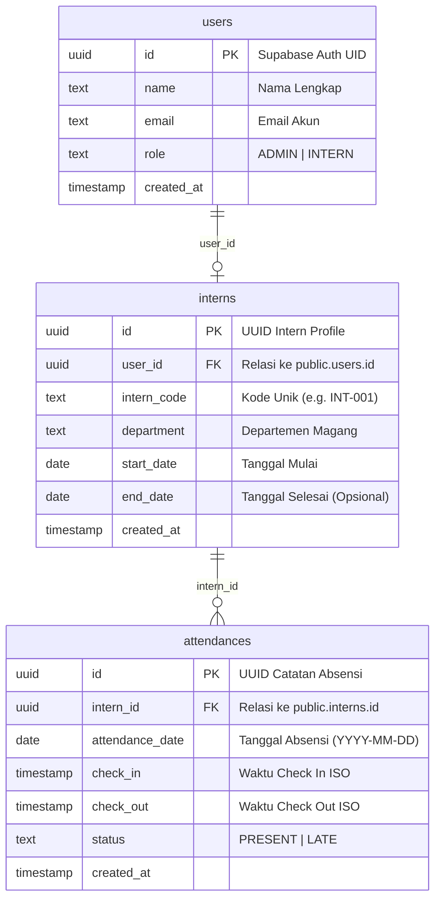
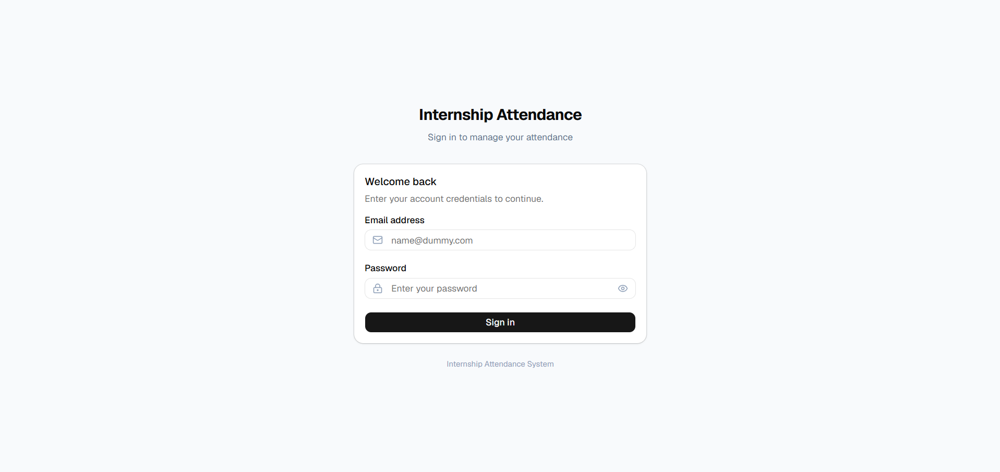
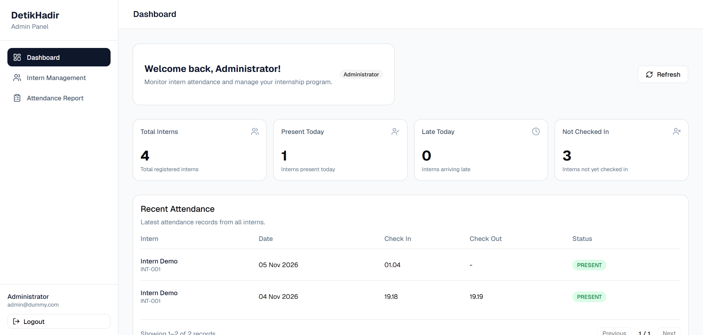
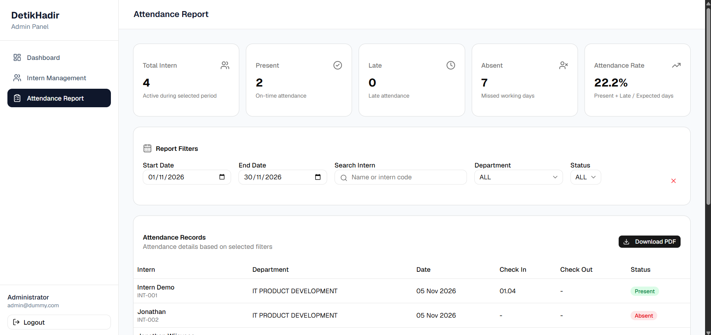

# DetikHadir — Sistem Absensi Peserta Magang Detikcom

Aplikasi berbasis web untuk manajemen kehadiran peserta magang di Detikcom. Mengakomodasi dua role pengguna (**Admin** dan **Intern**) dengan hak akses, operasional harian, rekapitulasi data kehadiran, dan pelaporan komprehensif.

---

## 1. Link Aplikasi & Demo

| Komponen | URL Deployment |
| :--- | :--- |
| **Aplikasi Frontend** | https://jonathan-wijaya-fullstack-developer.vercel.app |
| **Backend API** | https://jonathan-wijaya-backend-detikcom.vercel.app |

### Akun Demo untuk Pengujian

| Role | Email | Password |
| :--- | :--- | :--- |
| Admin | admin@dummy.com | admin123 |
| Intern | intern@dummy.com | intern |

*Catatan: Akun Intern dengan password default `intern` akan otomatis memicu dialog wajib ganti password pada login pertama.*

---

## 2. Fitur Utama

### A. Intern Portal
1. **Autentikasi & Proteksi Sesi**: Login berbasis JWT Supabase Auth dengan role verification dari database.
2. **Paksa Ganti Password**: Deteksi password default `intern` pada login pertama untuk memandu peserta memperbarui kredensial.
3. **Pencatatan Kehadiran Harian**:
   - Check-in 1 kali sehari dengan penentuan status otomatis (*Present* atau *Late*).
   - Check-out 1 kali sehari yang memvalidasi bahwa check-in telah dilakukan sebelumnya.
4. **Riwayat Kehadiran Mandiri**:
   - Menampilkan tanggal, jam check-in, jam check-out, durasi kerja harian (`HH:mm`), dan status kehadiran.
   - Paginasi server-side dan filter berdasarkan bulan.

### B. Admin Panel
1. **Operational Dashboard (Harian)**:
   - Kartu ringkasan kondisi hari ini: *Total Interns*, *Present Today*, *Late Today*, dan *Not Checked In*.
   - Tabel *Recent Attendance* dari seluruh intern.
   - **Pemantauan Operasional Harian**: Daftar nama intern aktif yang **Belum Check-in Hari Ini** dan daftar intern yang **Sudah Check-in tapi Belum Check-out**.
2. **Manajemen Peserta Magang**:
   - Pencarian, filter departemen, filter status (*Active*, *Upcoming*, *Completed*).
   - Tambah intern baru (otomatis membuat akun Supabase Auth dan profil DB dengan password default `intern`).
   - Edit data intern dan hapus akun beserta riwayat absensinya (dengan konfirmasi dialog).
3. **Attendance Report & Rekapitulasi**:
   - Kartu metrik: *Total Intern*, *Present*, *Late*, *Absent*, dan *Attendance Rate (%)*.
   - Filter rentang tanggal, pencarian nama/kode, departemen, dan status.
   - **Visualisasi Data (Recharts)**: Grafik batang tren kehadiran harian dan diagram donat distribusi status kehadiran.
   - Tabel catatan kehadiran lengkap dengan kolom **Durasi Kerja** (`HH:mm`).
   - **Koreksi Absensi**: Admin dapat mengoreksi jam masuk/pulang peserta (misal saat lupa check-out).
   - **Export Laporan**: Ekspor ke format **PDF** dan **CSV** yang memuat seluruh halaman data terfilter.

---

## 3. Aturan Bisnis (Business Rules)

1. **Zona Waktu**: Seluruh perhitungan tanggal, jam check-in, dan batas waktu absensi menggunakan zona waktu Indonesia Barat (**Asia/Jakarta / WIB**).
2. **Jam Kerja & Batas Keterlambatan (Late)**:
   - Jam masuk standar: **09:00:00 WIB**.
   - Check-in pada atau sebelum `09:00:00 WIB` dicatat sebagai **PRESENT** (Hadir tepat waktu).
   - Check-in setelah `09:00:00 WIB` otomatis dicatat sebagai **LATE** (Terlambat).
3. **Aturan Check-In & Check-Out**:
   - Check-in hanya dapat dilakukan maksimal 1 kali per hari.
   - Check-out hanya dapat dilakukan maksimal 1 kali per hari dan wajib dilakukan setelah check-in pada hari yang sama.
4. **Hari Kerja & Hari Libur**:
   - Hari kerja resmi adalah **Senin sampai Jumat**.
   - Hari Sabtu, Minggu, dan Hari Libur Nasional Indonesia dikecualikan dari hari kerja aktif.
5. **Status Hari Berjalan (Not Checked In vs Absent)**:
   - Pada hari kerja yang sedang berjalan (*today*), peserta yang belum melakukan check-in dilabeli sebagai **Not Checked In**, bukan Absent.
   - Status **ABSENT** hanya dihitung untuk hari kerja yang sudah lewat (*past working days*).
6. **Formula Attendance Rate**:
   $$\text{Attendance Rate} = \frac{\text{Present} + \text{Late}}{\text{Total Expected Working Days}} \times 100\%$$
   - Total expected working days dihitung per peserta berdasarkan irisan rentang tanggal aktif magang peserta (`start_date` sampai `min(end_date, today)`). Hari di masa depan tidak diperhitungkan.

---

## 4. Skema Basis Data (ERD)

Aplikasi menggunakan PostgreSQL via Supabase dengan skema relasi sebagai berikut:



---

## 5. Struktur Folder Proyek

```
Jonathan Wijaya_Fullstack Developer_Detikcom/
├── backend/
│   ├── src/
│   │   ├── config/
│   │   │   ├── constants.ts          # Konstanta jam masuk, timezone, libur nasional
│   │   │   └── supabase.ts           # Inisialisasi Supabase client (Auth & Admin)
│   │   ├── middlewares/
│   │   │   └── auth.middleware.ts    # Middleware autentikasi token & role guard (RBAC)
│   │   ├── modules/
│   │   │   ├── attendance/           # Controller & routing absensi intern & admin
│   │   │   ├── auth/                 # Controller & routing login & change password
│   │   │   ├── dashboard/            # Controller & routing dashboard admin & intern
│   │   │   └── interns/              # Controller & routing CRUD data peserta magang
│   │   ├── utils/
│   │   │   ├── attendance.util.ts    # Logic status, durasi, rumus rate, hari libur
│   │   │   └── attendance.util.test.ts # 21 Unit test logika absensi
│   │   ├── app.ts                    # Express app setup, CORS, rate limiter
│   │   └── server.ts                 # Server entry point
│   ├── package.json
│   └── tsconfig.json
│
├── frontend/
│   ├── src/
│   │   ├── components/
│   │   │   ├── layout/               # Layout responsive (AdminLayout & InternLayout)
│   │   │   ├── ui/                   # Komponen shadcn/ui (Button, Card, Dialog, Table, dll.)
│   │   │   └── ProtectedRoute.tsx    # Client-side route protection berdasarkan role
│   │   ├── context/
│   │   │   └── AuthContext.tsx       # State manajemen sesi autentikasi pengguna
│   │   ├── lib/
│   │   │   └── utils.ts              # Format jam HH:mm, tanggal, dan durasi kerja
│   │   ├── pages/
│   │   │   ├── admin/
│   │   │   │   ├── AdminDashboard.tsx    # Dashboard operasional harian admin
│   │   │   │   ├── AttendanceReport.tsx  # Laporan absensi, charts, koreksi, export
│   │   │   │   └── InternManagement.tsx  # CRUD data peserta magang
│   │   │   ├── intern/
│   │   │   │   └── InternDashboard.tsx   # Dashboard absensi & riwayat peserta
│   │   │   └── Login.tsx             # Halaman login aplikasi
│   │   ├── services/
│   │   │   └── api.ts                # Konfigurasi instance Axios & auth interceptor
│   │   ├── types/
│   │   │   └── index.ts              # Type definitions TypeScript
│   │   ├── App.tsx                   # Routing utama aplikasi
│   │   └── main.tsx
│   ├── package.json
│   └── vite.config.ts
└── README.md
```

---

## 6. Environment Variables

### Backend (`backend/.env`)

```env
PORT=5000
SUPABASE_URL=https://your-project.supabase.co
SUPABASE_PUBLISHABLE_KEY=your-supabase-publishable-key
SUPABASE_SECRET_KEY=your-supabase-service-role-secret-key
```

### Frontend (`frontend/.env`)

```env
VITE_API_URL=http://localhost:5000/api
```

---

## 7. Panduan Menjalankan Secara Lokal

### Prasyarat
- Node.js versi 20+ (disarankan Node.js v22)
- npm versi 10+

### Langkah 1: Clone Repository
```bash
git clone https://github.com/jonathanwijayaa/Jonathan-Wijaya_Fullstack-Developer_Detikcom.git
cd "Jonathan-Wijaya_Fullstack-Developer_Detikcom"
```

### Langkah 2: Setup & Jalankan Backend
```bash
cd backend
npm install
npm run build
npm run dev
```
Backend akan aktif di `http://localhost:5000`.

Untuk menjalankan unit test backend:
```bash
npm test
```

### Langkah 3: Setup & Jalankan Frontend
Buka terminal baru di direktori root proyek:
```bash
cd frontend
npm install
npm run dev
```
Frontend akan aktif di `http://localhost:5173`.

---

## 8. Keputusan Teknis & Trade-offs

1. **Pemisahan Operasional Harian vs Tren Analitik**:
   - *Keputusan*: Admin Dashboard difokuskan murni untuk operasional harian (*kondisi hari ini*: siapa yang hadir, siapa yang terlambat, siapa yang belum check-in, dan siapa yang belum check-out).
   - *Trade-off*: Grafik tren historis dan diagram distribusi dipusatkan di halaman *Attendance Report*, menjaga Admin Dashboard tetap ringan dan fokus sebagai alat kontrol harian.
2. **Server-side Computation untuk Absent & Rate**:
   - *Keputusan*: Status Absent tidak disimpan secara statis setiap malam di database, melainkan dikomputasi secara dinamis berdasarkan irisan hari kerja aktif (*working days*) vs data absensi aktual.
   - *Keuntungan*: Tidak membutuhkan cron job scheduler database yang rentan gagal jika server mati. Data laporan selalu mutakhir saat filter tanggal diubah.
3. **Rollback Multi-step pada Pembuatan Intern**:
   - *Keputusan*: Operasi `createIntern` mencakup pembuatan akun Supabase Auth, baris `public.users`, dan baris `public.interns`. Jika salah satu tahapan gagal, sistem otomatis melakukan kompensasi penghapusan (*rollback*) akun auth yang sudah terlanjur dibuat agar tidak terjadi akun yatim (*orphaned users*).
4. **Rate Limiting pada Endpoint Login**:
   - *Keputusan*: Menggunakan `express-rate-limit` (15 request per 15 menit per IP) untuk mencegah percobaan serangan *brute force* pada kredensial pengguna.
5. **Format Waktu Terpusat**:
   - *Keputusan*: Satu set helper fungsi terpusat (`formatTime`, `formatDate`, `formatDuration`) dipakai di seluruh halaman untuk menjamin konsistensi format `HH:mm` dan timezone `Asia/Jakarta`.

---

## 9. Rencana Pengembangan Selanjutnya (Roadmap)

- [ ] **Geofencing / Lokasi Kantor**: Validasi koordinat GPS saat check-in agar peserta hanya dapat melakukan absensi di area kantor Detikcom.
- [ ] **Selfie / Face Recognition**: Integrasi foto selfie saat check-in untuk mencegah penitipan absensi antar peserta.
- [ ] **Pengajuan Izin / Cuti**: Formulir izin sakit/cuti magang dengan persetujuan (*approval workflow*) dari Admin/Mentor.
- [ ] **Notifikasi Otomatis**: Integrasi bot Telegram atau webhook Slack pengingat check-in pukul 08:45 WIB dan check-out pukul 17:00 WIB.

---

## 10. Tampilan Antarmuka

### Login


### Admin Dashboard (Operasional Harian)


### Admin Intern Management


### Admin Attendance Report (Grafik & Rekap)


### Intern Dashboard (Absensi & Riwayat)


---

**Dikembangkan oleh:** Jonathan Wijaya  
**Assignment:** Fullstack Developer Internship — Detikcom
